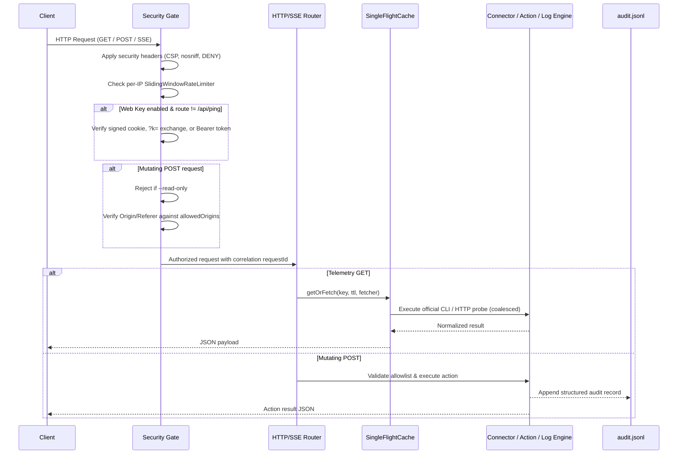

# Architecture

Ops Console v2.0.0 is designed as a self-contained, zero-dependency Node.js (>= 20 LTS ESM) control plane. Every subsystem favors explicit allowlists, bounded resource usage, official upstream protocols, and graceful degradation when optional components are absent.

---

## 1. Module Map

```text
ops-console/
├── bin/
│   └── ops-console.mjs          # CLI entry: flag parsing, --check-config, multi-host server bootstrap, graceful shutdown
├── src/
│   ├── config.mjs               # Precedence loader, schema validation, unit/timer/logFile allowlist lookup
│   ├── security.mjs             # Timing-safe Web Key auth, signed cookies, CSRF Origin guard, CSP headers, realpath containment, sliding-window rate limiter
│   ├── exec.mjs                 # Safe execFile runner (shell: false), bounded stdout/stderr, user environment normalization, AbortController HTTP probe
│   ├── cache.mjs                # SingleFlightCache: TTL caching, concurrent in-flight deduplication, stale-on-error fallback
│   ├── logger.mjs               # StructuredLogger: JSONL file sink with 5 MB x 5 rotation, in-memory ring buffer, EventEmitter live fan-out
│   ├── logs.mjs                 # Unified log query (journalctl JSON + allowlisted files + self-log), severity histogram, export, SSE live tail
│   ├── actions.mjs              # Allowlisted systemd/timer controls, health & backup job runner with overlap guards, audit.jsonl recorder
│   ├── demo.mjs                 # Deterministic sandbox snapshot generator + simulated SSE log emitter for --demo mode
│   ├── server.mjs               # HTTP/SSE request router, static asset handler, multi-host binding lifecycle
│   └── connectors/              # Pluggable official-protocol telemetry adapters
│       ├── host.mjs             # Host CPU, memory, load, uptime, and disk mount collectors
│       ├── systemd.mjs          # Batched `systemctl show` for services & timers
│       ├── memory-nmem.mjs      # Nowledge Mem `/health` + `nmem --json` status, stats, spaces, feed, search, doctor
│       ├── memory-openviking.mjs# OpenViking `/health`, `/ready` + `ov -o json` health, status, skills, find
│       ├── memory-symbiote.mjs  # Symbiote `/api/health` workbench probe
│       ├── memory-rerank.mjs    # Rerank / Embedding `/health` gateway probes
│       └── ...                  # Gateway (Magpie), mesh/network (Tailscale, Mihomo, Syncthing), remote SSH nodes, custom HTTP probes
├── public/
│   ├── index.html               # Single-page architectural instrument shell (7 views)
│   ├── styles.css               # Design tokens, light/dark themes, responsive desktop & mobile grids
│   └── app.js                   # Zero-build ESM frontend: state store, topology renderer, SSE log stream client
├── deploy/
│   ├── install.sh               # Portable POSIX/bash installer & config scaffolder
│   └── systemd/                 # User & hardened system service unit templates
└── test/                        # Node.js built-in test runner (`node --test`) suites
```

---

## 2. Request Lifecycle



### Multi-Host Binding

Instead of binding `0.0.0.0`, `bin/ops-console.mjs` instantiates an `http.Server` listener for each configured address in `console.hosts` (for example `["127.0.0.1", "100.64.0.10"]`) sharing the same request handler and active connection tracker. On `SIGTERM` or `SIGINT`, all listeners stop accepting new connections, active SSE streams receive clean termination, child log-tail processes are killed, and open sockets drain gracefully before exit.

---

## 3. Connector Contract

Every connector under `src/connectors/` adheres to the following invariants:

1. **Official Protocols Only**: Connectors communicate exclusively through documented HTTP health/API routes or structured CLI flags (`--json`, `-o json`, `--output=json`). Never parse undocumented internal database files or scrape private host state.
2. **Zero Hardcoded Secrets**: Secrets (such as Mihomo controller secret or Syncthing API key) come solely from user configuration or environment variables (`MIHOMO_API_SECRET`, `SYNCTHING_API_KEY`).
3. **Timeout & Output Bounds**: Every subprocess runs through `runCmd()` (`execFile` with `shell: false`, explicit `timeout`, and `maxBuffer`), and every HTTP probe runs through `httpProbe()` with `AbortController` timeouts.
4. **Graceful Degradation**: Each connector returns a normalized status envelope:

```js
{
  enabled: true,        // false when disabled in config
  available: true,      // false when binary/endpoint is unreachable
  status: 'ok',         // 'ok' | 'degraded' | 'offline' | 'disabled'
  latencyMs: 14,        // probe round-trip latency
  collectedAt: '...',   // ISO-8601 timestamp
  data: {},             // connector-specific structured metrics
  error: null           // sanitized error summary if degraded/offline
}
```

If one connector times out or its binary is missing on the host, the rest of `/api/snapshot` still succeeds normally.

---

## 4. Unified Logging & SSE Pipeline

Ops Console aggregates three log sources behind one structured schema (`ts`, `level`, `source`, `unit`, `message`, `meta`):

1. **Systemd Journal (`journalctl --output=json`)**:
   - Queries only allowlisted units defined in `services` and `timers` (plus optional system scope validation).
   - Supports server-side filtering by severity (`err`, `warn`, `info`, `debug`), time window (`15m`..`7d`), plain keyword, or bounded regex, and computes a severity breakdown histogram.
2. **Allowlisted File Logs**:
   - Only files explicitly listed in `logFiles` can be queried.
   - Before opening a file, `resolveSafePath()` resolves symlinks with `fs.realpath` and verifies path containment.
   - Tail reading seeks from the end of the file in fixed byte chunks rather than loading multi-gigabyte logs into memory.
3. **Ops Console Self-Log (`StructuredLogger`)**:
   - Writes structured JSONL to `<dataDir>/ops-console.jsonl` with automatic size rotation (`5 MB x 5` archives).
   - Maintains a fixed-capacity in-memory ring buffer and emits events for zero-disk-poll live streaming.

### SSE Live Tail (`GET /api/logs/stream`)

- Enforces `security.maxSseStreams` (default `8`) to prevent file-descriptor or process exhaustion.
- Emits periodic SSE comment heartbeats (`: keepalive`) so reverse proxies (Tailscale Serve, Nginx, Caddy) keep connections open cleanly.
- Binds `req.on('close', ...)` and server shutdown hooks directly to `child.kill('SIGTERM')` (with `SIGKILL` fallback) so `journalctl -f` never leaks orphaned subprocesses.
- Supports one-click filtered export via `GET /api/logs/export?format=jsonl|text`.

---

## 5. Caching & Single-Flight Concurrency

`SingleFlightCache` (`src/cache.mjs`) prevents thundering-herd storms when multiple browser tabs or dashboards poll `/api/snapshot` or `/api/remotes` simultaneously:

- **In-Flight Coalescing**: Concurrent requests for the same cache key await a single shared Promise instead of spawning duplicate `systemctl`, `nmem`, `ov`, or `ssh` processes.
- **Per-Key TTL**: Fast local probes use short TTLs (a few seconds), while remote SSH probes default to a 60-second TTL (bypassable via `?refresh=1`).
- **Stale-on-Error Fallback**: If a refresh fails due to a transient timeout, the cache may return the last known good value marked as stale while surfacing the error metadata rather than blanking the UI.

---

## 6. Security Threat Model Summary

| Threat | Primary Mitigation |
| --- | --- |
| **Command injection via unit/query inputs** | Exclusive use of `execFile` / `spawn` with `shell: false`; strict regex validation on unit names (`UNIT_RE`) and allowlist lookup before execution. |
| **Arbitrary file read / symlink escape** | File log IDs map strictly to configured `logFiles`; `fs.realpath` containment checks prevent symlink traversal. |
| **Cross-Site Request Forgery (CSRF)** | All mutating `POST` routes verify `Origin` / `Referer` against host + `security.allowedOrigins`; session cookie uses `SameSite=Lax`. |
| **Unauthorized network exposure** | Defaults to `127.0.0.1` loopback; multi-host binding avoids `0.0.0.0`; optional Web Key (`>= 16` chars) with timing-safe comparison (`crypto.timingSafeEqual`) and signed `HttpOnly` session cookie. |
| **Accidental or unauthorized mutation** | `--read-only` / `OPS_CONSOLE_READ_ONLY=1` disables all write routes server-side; critical services carry risk metadata; every mutation writes an immutable entry to `audit.jsonl`. |
| **Resource exhaustion / DoS** | Separate per-IP sliding-window rate limits for read (`rateLimitPerMinute`) and mutating (`mutatingRateLimitPerMinute`) endpoints, 64 KB JSON body cap, `maxSseStreams` cap, subprocess timeouts and buffer caps. |

For reporting vulnerabilities and production hardening steps, see [SECURITY.md](./SECURITY.md).
