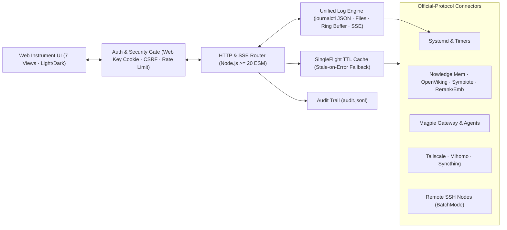

# Ops Console

**Self-Hostable Architecture, Service, Memory & Log Control Plane**

English | [简体中文](./README.zh-CN.md)

[](./CHANGELOG.md)
[](https://nodejs.org/)
[](#feature-matrix)
[](./LICENSE)
[](./.github/workflows/ci.yml)

Ops Console is a zero-dependency Node.js control plane that unifies service orchestration, AI memory & context telemetry, mesh networking inspection, remote SSH node health, and real-time structured log exploration in a single self-hosted web instrument.

---

## Architecture



---

## 3-Second Quickstart (Demo Mode)

Run Ops Console on Linux, macOS, or Windows with built-in sandbox topology and simulated live SSE log streaming — no systemd or backend services required:

```bash
git clone https://github.com/ops-console/ops-console.git
cd ops-console
npm run demo
# Or invoke the CLI directly:
node bin/ops-console.mjs --demo --port 4320
```

Open `http://127.0.0.1:4320` in your browser to explore all 8 views immediately (including the offline Global Fleet Map and Probe Manager).

---

## Feature Matrix

| Area | Capabilities |
| --- | --- |
| **Web Instrument UI** | Zero-CDN light & dark themes, responsive desktop + mobile layout, 8 dedicated views: **Overview & Topology**, **Global Fleet & Probes**, **Services**, **Memory & Context**, **Agents & Gateway**, **Network**, **Log Explorer**, and **Ops & Audit**. |
| **Multi-Device Fleet & `ops-probe`** | Offline Natural Earth 1:110m vector world map, per-node SVG sparklines, push-only Linux/macOS probe (`probe/`), and privacy-first mobile one-tap check-in with zero GPS tracking and zero reverse command channel. |
| **Official Connectors** | Pluggable connectors speaking official HTTP APIs and structured CLI JSON (`nmem`, `ov`, `magpie`, `tailscale`, `systemctl`, `journalctl`, Mihomo REST, Syncthing REST, Symbiote, Rerank/Embedding, SSH). |
| **Unified Log System** | Structured `journalctl --output=json` queries (unit, severity `err`/`warn`/`info`/`debug`, range `15m..7d`, keyword/regex, severity histogram), allowlisted file logs with `realpath` containment, rotating self-logs (`5 MB x 5`), live SSE tail, and one-click `jsonl`/`text` export. |
| **Operations & Audit** | Safe allowlisted service/timer actions, critical-service risk prompts, Read-Only mode, health & backup triggers, and structured `audit.jsonl` recording actor, IP, request ID, target, action, duration, and result. |
| **Security & Resilience** | Pure `execFile` execution (zero shell injection), CSRF Origin/Referer checks, sliding-window rate limiting, CSP & security headers, optional Web Key signed cookie auth, SingleFlight TTL cache with stale-on-error fallback, graceful `SIGTERM`/`SIGINT` shutdown. |
| **Zero-Dependency Runtime** | Pure Node.js >= 20 LTS ESM. Zero npm runtime packages to audit, patch, or bundle. |

---

## Configuration & CLI

### Configuration Resolution Order

Ops Console resolves configuration in strict precedence order:

1. CLI flag: `--config <path>`
2. Environment variable: `OPS_CONSOLE_CONFIG`
3. Local override: `./config.local.json` (git-ignored)
4. User config: `~/.config/ops-console/config.json`
5. Built-in generic defaults

Copy the example configuration to get started:

```bash
cp ops-console.config.example.json config.local.json
node bin/ops-console.mjs --check-config --config ./config.local.json
```

### CLI Flags & Environment Variables

| CLI Flag | Environment Variable | Default | Description |
| --- | --- | --- | --- |
| `--config <path>` | `OPS_CONSOLE_CONFIG` | auto-resolved | Path to JSON configuration file. |
| `--host <addr>` / `--hosts <a,b>` | `OPS_CONSOLE_HOST` / `OPS_CONSOLE_HOSTS` | `127.0.0.1` | Comma-separated bind addresses (e.g. `127.0.0.1,100.64.0.10`). |
| `--port <port>` | `OPS_CONSOLE_PORT` | `4320` | Listening TCP port. |
| `--web-key <key>` | `OPS_CONSOLE_WEB_KEY` | disabled | Shared key (`>= 16` chars) enabling signed cookie + Bearer auth. |
| `--read-only` | `OPS_CONSOLE_READ_ONLY=1` | `false` | Disables all mutating control/ops endpoints. |
| `--demo` | `OPS_CONSOLE_DEMO=1` | `false` | Starts with built-in sandbox data and simulated live SSE logs. |
| — | `OPS_CONSOLE_DATA_DIR` | `./data` | Override directory for self-logs, `audit.jsonl`, and runtime state. |
| — | `MIHOMO_API_SECRET` | — | Bearer secret for Mihomo REST API connector (optional). |
| — | `SYNCTHING_API_KEY` | — | API key for Syncthing connector (optional). |
| `--check-config` | — | — | Validates resolved configuration and exits `0` on success. |
| `--version` | — | — | Prints version (`2.1.0`) and exits. |

### Probe Management Subcommands

```bash
# Enroll a Linux/macOS/mobile node and print a one-time ops_prb_* token + install command
ops-console probe enroll --id edge-tokyo-01 --name "Tokyo Edge" --type server --region "Tokyo, JP" --lat 35.68 --lon 139.69

# List enrolled probe tokens (metadata only; never exposes plaintext tokens)
ops-console probe list

# Immediately revoke a node's push token
ops-console probe revoke --id edge-tokyo-01
```

See [`probe/README.md`](./probe/README.md) and [`deploy/probe/mobile-checkin.md`](./deploy/probe/mobile-checkin.md) for Linux `systemd`, macOS `LaunchAgent`, and Android/iOS setup.
| `--help` | — | — | Displays CLI usage summary. |

---

## Deployment Guides

### 1. Direct Node.js (Loopback + Tailnet Multi-Host Binding)

Bind explicitly to loopback and your private Tailnet IP without exposing `0.0.0.0` or altering host firewall rules:

```bash
OPS_CONSOLE_WEB_KEY="replace-with-32-char-random-secret" \
  node bin/ops-console.mjs \
  --config ~/.config/ops-console/config.json \
  --hosts 127.0.0.1,100.64.0.10 \
  --port 4320
```

Authenticate once in a browser using `http://100.64.0.10:4320/?k=<your-web-key>` (or via the built-in sign-in screen). Ops Console strips `?k=` from the URL via redirect and sets a signed `HttpOnly; SameSite=Lax` cookie valid for 400 days. Programmatic clients may send `Authorization: Bearer <your-web-key>`.

### 2. Docker & Docker Compose

```bash
cp ops-console.config.example.json config.local.json
OPS_CONSOLE_WEB_KEY="replace-with-32-char-random-secret" docker compose up -d
```

To launch Docker directly in sandbox demo mode:

```bash
OPS_CONSOLE_DEMO=1 docker compose up --build
```

See [Dockerfile](./Dockerfile) and [docker-compose.yml](./docker-compose.yml).

### 3. Systemd (User or System Service)

Run the portable installer script to verify Node.js >= 20, scaffold `~/.config/ops-console/config.json`, and optionally install the user systemd service:

```bash
./deploy/install.sh --with-systemd
```

Manual templates are available in:

- [deploy/systemd/ops-console.user.service](./deploy/systemd/ops-console.user.service) — User-level unit (`systemctl --user`)
- [deploy/systemd/ops-console.system.service](./deploy/systemd/ops-console.system.service) — Hardened system-level unit (`ProtectSystem=strict`, `PrivateTmp=true`)

### 4. Tailscale Serve (HTTPS Ingress)

Keep Ops Console bound solely to `127.0.0.1:4320` and terminate TLS via Tailscale Serve:

```bash
tailscale serve --bg --https=8444 http://127.0.0.1:4320
```

Add `https://node.example.ts.net:8444` to `security.allowedOrigins` in your config so CSRF checks permit browser mutations from the Tailnet origin.

---

## Official-Protocol Connectors

All connectors are optional, gracefully degrade when disabled or unreachable, and speak only documented upstream protocols with zero hardcoded secrets:

| Connector | Official Protocol / CLI | Collected Telemetry |
| --- | --- | --- |
| **Systemd** | `systemctl show` (batched), `journalctl --output=json` | Service active/sub/main PID, memory/CPU, timers, structured logs |
| **Nowledge Mem** | `GET /health`, `nmem --json` (`status`, `stats`, `spaces`, `feed`, `search`, `doctor`) | Engine health, unit counts, spaces, recent feed, diagnostics |
| **OpenViking** | `GET /health`, `GET /ready`, `ov -o json` (`health`, `status`, `skills`, `find`) | Component health metrics, registered skills, context retrieval |
| **Symbiote** | `GET /api/health` | Reading workbench liveness and status payload |
| **Rerank / Embedding** | `GET /health` | Local model gateway readiness and latency |
| **Magpie Gateway** | OpenAI `GET /v1/models`, `magpie ls`, `magpie library` | Routed model catalog, running bridges, MCP/library inventory |
| **Tailscale** | `tailscale status --json`, `tailscale serve status --json` | Self/peer mesh state, Tailnet IPs, active HTTPS Serve routes |
| **Mihomo (Clash Meta)** | `GET /version`, `/connections`, `/proxies` (Bearer secret from env) | Proxy core version, live connection counts, active selectors |
| **Syncthing** | `GET /rest/noauth/health` | Sync daemon liveness |
| **Remote SSH Nodes** | `ssh -o BatchMode=yes` with configurable `StrictHostKeyChecking` (60s TTL cache) | Remote uptime, load, memory, disk, and backup freshness |
| **Generic HTTP Probes** | `GET <healthUrl>` per configured service | HTTP status code and round-trip latency |

---

## REST & SSE API Reference

| Method & Path | Access | Description |
| --- | --- | --- |
| `GET /api/ping` | Public | Lightweight liveness probe (`200 OK`) for Docker/systemd healthchecks. |
| `GET /api/snapshot` | Read | Aggregated topology, host metrics, services, timers, connectors, and running jobs. |
| `GET /api/fleet` (`GET /api/nodes`) | Read | Unified multi-device fleet view fusing local hub, `ops-probe` push telemetry, SSH nodes, and Tailscale peers. |
| `GET /api/nodes/:id` | Read | Detailed node state plus bounded time-series history for sparkline rendering. |
| `GET /api/probes` | Read | Enrolled probe metadata (scopes, type, region; never exposes tokens). |
| `POST /api/probes/ingest` | Probe Token | Push-only telemetry ingest authenticated by per-node `Bearer ops_prb_*` + `X-Ops-Probe-Id` (restricted to Tailnet/loopback CIDR by default). |
| `POST /api/probes/checkin` | Session / Read | Privacy-first mobile Web UI check-in (RTT, optional battery/network; zero GPS). |
| `POST /api/probes/enroll` | Mutate | Issue a one-time `ops_prb_*` token and install snippets. Blocked in `--read-only`. |
| `DELETE /api/probes/:id` | Mutate | Revoke an enrolled probe token immediately. Blocked in `--read-only`. |
| `GET /api/remotes?refresh=1` | Read | Remote SSH node health summary (cached 60s unless `refresh=1`). |
| `GET /api/logs` | Read | Structured log query (`source`, `unit`, `file`, `severity`, `since`, `q`, `regex`, `limit`). |
| `GET /api/logs/stream` | Read (SSE) | Real-time `text/event-stream` tail with heartbeat, concurrency cap, and child-process cleanup. |
| `GET /api/logs/export` | Read | Download filtered logs (`?format=jsonl` or `?format=text`). |
| `GET /api/audit` | Read | Recent structured audit entries from `audit.jsonl`. |
| `POST /api/services/control` | Mutate | Allowlisted systemd action (`start`, `stop`, `restart`, `reload`). Blocked in `--read-only`. |
| `POST /api/timers/control` | Mutate | Allowlisted timer action (`start`, `stop`, `enable`, `disable`). Blocked in `--read-only`. |
| `POST /api/ops/health` | Mutate | Trigger configured health check script. Blocked in `--read-only`. |
| `POST /api/ops/backup` | Mutate | Trigger configured backup script. Blocked in `--read-only`. |

> **Note:** When `--web-key` / `OPS_CONSOLE_WEB_KEY` is configured, all routes except `/api/ping` and the sign-in flow require a valid signed session cookie or `Authorization: Bearer <key>` header.

---

## Security & Hardening

- **Zero Shell Interpolation**: Every subprocess uses `child_process.execFile` / `spawn(..., { shell: false })` with static argument vectors.
- **Strict Allowlists**: Only units, timers, log files, and scripts explicitly declared in configuration can be queried or controlled.
- **Path Containment**: File log readers resolve symlinks via `fs.realpath` and verify strict prefix containment before reading tail chunks.
- **CSRF & Rate Limiting**: Mutating `POST` requests validate `Origin`/`Referer` against `security.allowedOrigins` and pass through a per-IP sliding-window rate limiter.
- **Read-Only Mode**: Run with `--read-only` or `OPS_CONSOLE_READ_ONLY=1` for purely observational dashboards.
- **Zero External CDN & Push-Only Telemetry**: Strict `default-src 'self'` CSP with offline vector maps; remote probes hold write-only telemetry tokens restricted to Tailnet/loopback CIDRs with zero remote command execution capability.

See [SECURITY.md](./SECURITY.md) for the complete threat model and hardening checklist.

---

## Development & Testing

```bash
npm run check   # Static syntax & config validation
npm test        # Node.js built-in test runner (node --test)
npm start       # Launch control plane
npm run demo    # Launch sandbox demo mode
```

## Documentation & Community

- [Architecture Guide](./ARCHITECTURE.md) — Module map, connector contract, SSE pipeline, caching, and threat model
- [Contributing Guide](./CONTRIBUTING.md) — Adding connectors, running tests, and PR guidelines
- [Security Policy](./SECURITY.md) — Reporting vulnerabilities and deployment hardening
- [Code of Conduct](./CODE_OF_CONDUCT.md) — Community standards
- [Changelog](./CHANGELOG.md) — Release history

## License

Released under the [MIT License](./LICENSE). Copyright (c) 2026 Ops Console Contributors.
