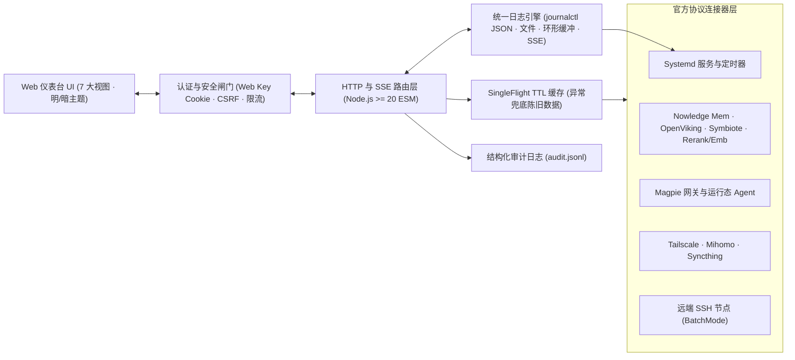

# Ops Console

**可自托管的架构、服务、记忆与日志统一控制平面**

[English](./README.md) | 简体中文

[](./CHANGELOG.md)
[](https://nodejs.org/)
[](#核心特性)
[](./LICENSE)
[](./.github/workflows/ci.yml)

Ops Console 是一个零外部运行时依赖的 Node.js 控制平面，将服务编排、AI 记忆与上下文遥测、Mesh 组网监测、远端 SSH 节点巡检以及实时结构化日志检索整合进一套轻量的自托管 Web 仪表台。

---

## 系统架构



---

## 3 秒快速体验（Demo 沙盒模式）

无需 systemd 或后端依赖，在 Linux、macOS 或 Windows 上即可启动内置沙盒拓扑与模拟实时 SSE 日志流：

```bash
git clone https://github.com/ops-console/ops-console.git
cd ops-console
npm run demo
# 或直接调用 CLI：
node bin/ops-console.mjs --demo --port 4320
```

浏览器打开 `http://127.0.0.1:4320` 即可体验全部 8 个功能视图（含离线全球节点地图与推送探针管理）。

---

## 核心特性

| 模块 | 能力说明 |
| --- | --- |
| **精密仪表台 UI** | 零外部 CDN 的浅色/深色响应式 Web UI，包含 8 个核心视图：**总览与拓扑**、**全球节点与探针**、**服务管理**、**记忆与上下文**、**Agent 与网关**、**网络**、**日志检索**、**运维与审计**。 |
| **多端全球舰队与 `ops-probe`** | 内置离线 Natural Earth 1:110m 矢量世界地图与实时 SVG 趋势折线图；提供零依赖只推送探针（Linux `systemd` / macOS `LaunchAgent`）与手机一键签到，不采集 GPS、无反向控制通道。 |
| **官方协议连接器** | 插件化架构，仅调用各组件官方 HTTP API 与结构化 CLI JSON（`nmem`、`ov`、`magpie`、`tailscale`、`systemctl`、`journalctl`、Mihomo REST、Syncthing REST、Symbiote、Rerank/Embedding、SSH），无硬编码密钥。 |
| **生产级统一日志系统** | 结构化 `journalctl --output=json` 查询（按单元、级别 `err`/`warn`/`info`/`debug`、时间范围 `15m..7d`、关键词/正则过滤及级别分布直方图）；基于 `realpath` 路径防逃逸的文件日志读取；自日志轮转（`5 MB x 5`）与内存环形缓冲；SSE 实时追踪及一键导出 `jsonl`/`text`。 |
| **运维操作与审计追踪** | 严格白名单控制服务/定时器启停与重载、高风险服务确认提示、只读模式（`--read-only`）、巡检与备份触发，以及记录操作者、IP、请求 ID、目标、动作、耗时与结果的 `audit.jsonl`。 |
| **安全与韧性设计** | 全程 `execFile` 无 Shell 注入、Origin/Referer CSRF 校验、滑动窗口限流、CSP 等安全响应头、可选 Web Key 签名 Cookie 认证、SingleFlight 并发合并与异常陈旧缓存兜底、优雅 `SIGTERM`/`SIGINT` 退出。 |
| **零依赖运行时** | 纯 Node.js >= 20 LTS 原生 ESM，零第三方 npm 运行时依赖，易于审计与离线部署。 |

---

## 配置与命令行参数

### 配置文件加载优先级

Ops Console 按以下顺序解析配置文件：

1. 命令行参数：`--config <path>`
2. 环境变量：`OPS_CONSOLE_CONFIG`
3. 当前目录覆盖：`./config.local.json`（已被 `.gitignore` 忽略）
4. 用户配置目录：`~/.config/ops-console/config.json`
5. 内置通用默认配置

复制示例配置并校验格式：

```bash
cp ops-console.config.example.json config.local.json
node bin/ops-console.mjs --check-config --config ./config.local.json
```

### CLI 参数与环境变量

| CLI 参数 | 环境变量 | 默认值 | 说明 |
| --- | --- | --- | --- |
| `--config <path>` | `OPS_CONSOLE_CONFIG` | 自动解析 | 指定 JSON 配置文件路径。 |
| `--host <addr>` / `--hosts <a,b>` | `OPS_CONSOLE_HOST` / `OPS_CONSOLE_HOSTS` | `127.0.0.1` | 逗号分隔的多地址绑定（如 `127.0.0.1,100.64.0.10`）。 |
| `--port <port>` | `OPS_CONSOLE_PORT` | `4320` | 监听端口。 |
| `--web-key <key>` | `OPS_CONSOLE_WEB_KEY` | 关闭 | 启用访问密钥认证（至少 16 字符），支持签名 Cookie 与 Bearer Token。 |
| `--read-only` | `OPS_CONSOLE_READ_ONLY=1` | `false` | 只读模式，禁用所有写操作与控制端点。 |
| `--demo` | `OPS_CONSOLE_DEMO=1` | `false` | 启用内置沙盒数据与模拟实时 SSE 日志。 |
| — | `OPS_CONSOLE_DATA_DIR` | `./data` | 覆盖自日志、`audit.jsonl` 与运行数据的存储目录。 |
| — | `MIHOMO_API_SECRET` | — | Mihomo REST API 鉴权密钥（可选）。 |
| — | `SYNCTHING_API_KEY` | — | Syncthing API 密钥（可选）。 |
| `--check-config` | — | — | 校验配置文件有效性后退出（成功返回 `0`）。 |
| `--version` | — | — | 输出版本号（`2.1.0`）并退出。 |

### 探针管理子命令

```bash
# 为远端服务器/笔记本/手机签发一次性 ops_prb_* 推送令牌与安装命令
ops-console probe enroll --id edge-tokyo-01 --name "Tokyo Edge" --type server --region "Tokyo, JP" --lat 35.68 --lon 139.69

# 列出已注册探针（仅元数据，绝不回显明文令牌）
ops-console probe list

# 立即吊销指定节点的探针凭据
ops-console probe revoke --id edge-tokyo-01
```

Linux `systemd`、macOS `LaunchAgent` 与手机端签到说明详见 [`probe/README.md`](./probe/README.md) 与 [`deploy/probe/mobile-checkin.md`](./deploy/probe/mobile-checkin.md)。
| `--help` | — | — | 显示命令行帮助信息。 |

---

## 部署指南

### 1. 直接通过 Node.js 运行（回环 + Tailnet 多地址绑定）

无需监听 `0.0.0.0` 或改动防火墙规则，直接同时绑定本机回环与 Tailnet 私网地址：

```bash
OPS_CONSOLE_WEB_KEY="replace-with-32-char-random-secret" \
  node bin/ops-console.mjs \
  --config ~/.config/ops-console/config.json \
  --hosts 127.0.0.1,100.64.0.10 \
  --port 4320
```

在浏览器首次访问 `http://100.64.0.10:4320/?k=<your-web-key>`（或通过登录页输入密钥），服务端将重定向清除 URL 中的 `?k=` 并签发有效期 400 天的 `HttpOnly; SameSite=Lax` 签名 Cookie。脚本与自动化工具可通过 `Authorization: Bearer <your-web-key>` 访问 API。

### 2. Docker 与 Docker Compose

```bash
cp ops-console.config.example.json config.local.json
OPS_CONSOLE_WEB_KEY="replace-with-32-char-random-secret" docker compose up -d
```

以 Demo 沙盒模式启动容器：

```bash
OPS_CONSOLE_DEMO=1 docker compose up --build
```

详见 [Dockerfile](./Dockerfile) 与 [docker-compose.yml](./docker-compose.yml)。

### 3. Systemd 服务部署（用户级 / 系统级）

使用便携安装脚本校验 Node.js >= 20、初始化 `~/.config/ops-console/config.json` 并按需注册用户级 systemd 服务：

```bash
./deploy/install.sh --with-systemd
```

如需手动配置，请参考以下模板：

- [deploy/systemd/ops-console.user.service](./deploy/systemd/ops-console.user.service) — 用户级服务单元（`systemctl --user`）
- [deploy/systemd/ops-console.system.service](./deploy/systemd/ops-console.system.service) — 加固系统级服务单元（启用 `ProtectSystem=strict` 与 `PrivateTmp=true`）

### 4. 配合 Tailscale Serve 提供私网 HTTPS

保持 Ops Console 仅监听 `127.0.0.1:4320`，由 Tailscale Serve 托管私网 TLS：

```bash
tailscale serve --bg --https=8444 http://127.0.0.1:4320
```

请在配置文件的 `security.allowedOrigins` 中加入 `https://node.example.ts.net:8444`，以便 CSRF 校验放行该私网域名的控制请求。

---

## 官方协议连接器清单

所有连接器均可按需启停；当目标服务未部署或暂时不可达时优雅降级，不阻塞整体快照：

| 连接器 | 官方协议 / CLI | 采集指标 |
| --- | --- | --- |
| **Systemd** | `systemctl show` 批量查询、`journalctl --output=json` | 服务运行态、PID、内存/CPU、定时器调度、结构化日志 |
| **Nowledge Mem** | `GET /health`、`nmem --json`（`status`/`stats`/`spaces`/`feed`/`search`/`doctor`） | 记忆引擎健康状态、记忆条目统计、空间列表、诊断结果 |
| **OpenViking** | `GET /health`、`GET /ready`、`ov -o json`（`health`/`status`/`skills`/`find`） | 组件健康指标、Skill 仓库清单、语义检索状态 |
| **Symbiote** | `GET /api/health` | 渐进阅读工作台存活性与健康详情 |
| **Rerank / Embedding** | `GET /health` | 本地重排与向量化网关健康与延迟 |
| **Magpie Gateway** | OpenAI `GET /v1/models`、`magpie ls`、`magpie library` | 模型路由列表、桥接运行态、MCP/Library 清单 |
| **Tailscale** | `tailscale status --json`、`tailscale serve status --json` | Mesh 节点在线态、Tailnet IP、Serve 暴露规则 |
| **Mihomo (Clash Meta)** | `GET /version`、`/connections`、`/proxies`（通过环境变量读取密钥） | 核心版本、活跃连接数、代理策略组状态 |
| **Syncthing** | `GET /rest/noauth/health` | 文件同步守护进程健康检查 |
| **远端 SSH 节点** | `ssh -o BatchMode=yes` 与可配置 `StrictHostKeyChecking`（60 秒缓存） | 远端负载、内存、磁盘及备份新鲜度 |
| **通用 HTTP 探测** | 按服务配置发起 `GET <healthUrl>` | HTTP 状态码与响应延迟 |

---

## REST 与 SSE API 参考

| 方法与路径 | 权限级别 | 功能描述 |
| --- | --- | --- |
| `GET /api/ping` | 公开 | 轻量级存活探针（`200 OK`），供 Docker/systemd 健康检查使用。 |
| `GET /api/snapshot` | 只读 | 获取架构拓扑、宿主机资源、服务/定时器、连接器状态与运行中任务快照。 |
| `GET /api/fleet`（`GET /api/nodes`） | 只读 | 获取融合本地中心、推送探针、SSH 远端主机与 Tailscale 设备的全网节点视图。 |
| `GET /api/nodes/:id` | 只读 | 获取单节点完整遥测与有界时序历史曲线数据。 |
| `GET /api/probes` | 只读 | 列出已签发探针的元数据与权限范围（不含明文令牌）。 |
| `POST /api/probes/ingest` | 探针令牌 | 只推送遥测写入接口，采用 `Bearer ops_prb_*` + `X-Ops-Probe-Id` 鉴权，默认限定 Tailnet/回环来源网段。 |
| `POST /api/probes/checkin` | 会话 / 只读 | 移动端 Web 一键签到（RTT、可选电量与网络制式，零 GPS 权限）。 |
| `POST /api/probes/enroll` | 变更 | 签发一次性探针令牌与各平台安装命令，`--read-only` 下禁用。 |
| `DELETE /api/probes/:id` | 变更 | 立即吊销探针令牌，`--read-only` 下禁用。 |
| `GET /api/remotes?refresh=1` | 只读 | 远端 SSH 节点状态汇总（默认缓存 60 秒，`refresh=1` 强制刷新）。 |
| `GET /api/logs` | 只读 | 结构化日志查询（支持 `source`、`unit`、`file`、`severity`、`since`、`q`、`regex`、`limit`）。 |
| `GET /api/logs/stream` | 只读（SSE） | 实时 `text/event-stream` 日志流，带心跳保活、并发数上限与子进程退出回收。 |
| `GET /api/logs/export` | 只读 | 导出过滤后的日志（支持 `?format=jsonl` 与 `?format=text`）。 |
| `GET /api/audit` | 只读 | 读取 `audit.jsonl` 中的最近运维审计记录。 |
| `POST /api/services/control` | 变更 | 白名单服务控制（`start`/`stop`/`restart`/`reload`），`--read-only` 下禁用。 |
| `POST /api/timers/control` | 变更 | 白名单定时器控制（`start`/`stop`/`enable`/`disable`），`--read-only` 下禁用。 |
| `POST /api/ops/health` | 变更 | 触发已配置的健康巡检脚本，`--read-only` 下禁用。 |
| `POST /api/ops/backup` | 变更 | 触发已配置的备份脚本，`--read-only` 下禁用。 |

> **说明**：启用 `--web-key` / `OPS_CONSOLE_WEB_KEY` 后，除 `/api/ping` 与登录鉴权路径外，所有接口均要求携带有效签名 Cookie 或 `Authorization: Bearer <key>` 请求头。

---

## 安全与加固概要

- **零 Shell 注入**：所有外部命令统一经 `execFile` / `spawn(..., { shell: false })` 以参数数组形式执行。
- **严格白名单**：仅配置文件显式声明的服务、定时器、日志文件与运维脚本允许被查询或操作。
- **路径防穿越**：文件日志读取先执行 `fs.realpath` 解析符号链接并校验路径前缀，仅以尾部块读取。
- **CSRF 与限流防护**：所有 `POST` 变更请求校验 `Origin`/`Referer` 并受每 IP 滑动窗口限流保护。
- **只读观测模式**：通过 `--read-only` 或 `OPS_CONSOLE_READ_ONLY=1` 一键关闭全部变更入口。
- **零外链 CSP 与单向推送边界**：严格 `default-src 'self'` 策略与离线地图资产；远端探针仅具备单向遥测写入权限，默认限制 Tailnet/回环来源网段，彻底消除反向控制攻击面。

完整威胁模型与部署加固清单请查阅 [SECURITY.md](./SECURITY.md)。

---

## 开发与测试

```bash
npm run check   # 静态语法与配置校验
npm test        # Node.js 内置测试运行器（node --test）
npm start       # 启动控制平面
npm run demo    # 启动沙盒演示模式
```

## 相关文档与社区

- [架构说明（ARCHITECTURE.md）](./ARCHITECTURE.md) — 模块划分、连接器契约、SSE 日志流水线与威胁模型
- [贡献指南（CONTRIBUTING.md）](./CONTRIBUTING.md) — 运行测试、新增官方连接器与 PR 规范
- [安全策略（SECURITY.md）](./SECURITY.md) — 漏洞披露流程与生产加固清单
- [行为准则（CODE_OF_CONDUCT.md）](./CODE_OF_CONDUCT.md) — 社区协作约定
- [变更日志（CHANGELOG.md）](./CHANGELOG.md) — 版本发布记录

## 开源协议

本项目采用 [MIT License](./LICENSE) 开源。Copyright (c) 2026 Ops Console Contributors.
